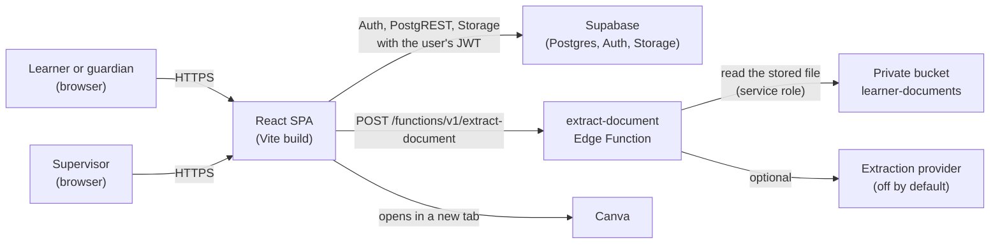
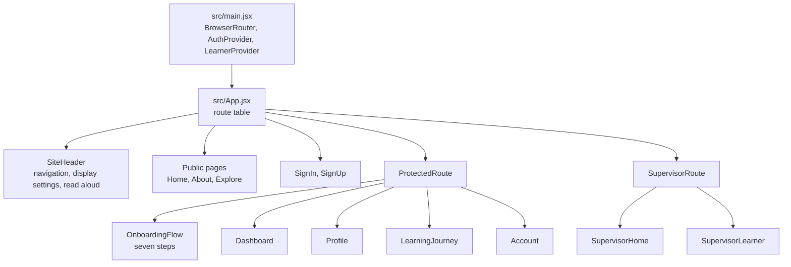
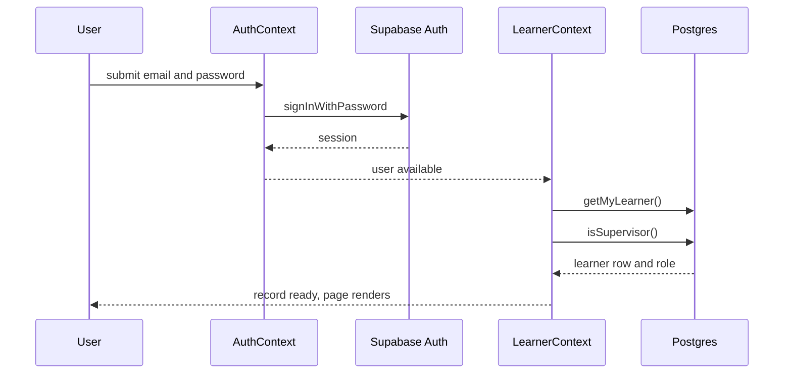

# Architecture overview

## What the product is

EABD (Empowering Ability Beyond Disability) helps a young person with a disability, or
the adult who supports them, record what helps them learn, follow a practical
learning pathway, and receive a supervisor's mark and comment on each step.

The pilot pathway is a four-week Canva design project. The design keeps the pathway
definition in code, so adding a second pathway is a data change rather than a schema
change.

## System context



The browser never holds a service role key. The only place a service role credential is
used is inside the Edge Function runtime, and only to read a file the caller has already
proven they own through row level security.

## Containers

| Container | Technology | Responsibility |
| --- | --- | --- |
| Browser application | React 19, React Router 7, Vite 7 | Routing, forms, adaptation of the interface, and all reads and writes that the user's own permissions allow |
| Authentication | Supabase Auth | Email and password, WebAuthn passkeys, session refresh |
| Database | Supabase Postgres with row level security | The learner record, progress, reviews, and supervisor assignment |
| File storage | Supabase Storage, private bucket | Uploaded documents, deletable on confirmation |
| Edge Function | Deno on Supabase | Reads one document and returns suggested fields with evidence |
| Hosting | Vercel (production) or nginx (Docker) | Serves the static bundle and rewrites unknown paths to `index.html` |

## Client structure



Three rules hold the structure together:

1. **Routes own data loading.** A page asks the data layer for what it needs. There is no
   global store for progress or reviews.
2. **Contexts own session state.** `AuthContext` owns the session. `LearnerContext` owns
   the learner record and whether the account is a supervisor.
3. **Shared components own presentation rules.** Field groups, banners, summaries, and
   review cards are mounted by several pages rather than copied.

## Data flow on sign-in



`LearnerContext` derives `loading` from `authLoading` and whether it has a record for the
current user id. A page therefore cannot render, and cannot write, while the record is
still loading. This is deliberate: an earlier build could show an empty record during
sign-in and then save that emptiness over real data.

## Data flow when a step is submitted and reviewed

```mermaid
sequenceDiagram
  participant L as Learner
  participant J as LearningJourney
  participant P as task_progress
  participant S as Supervisor
  participant R as task_reviews
  U as Trigger
  L->>J: Start in Canva
  J->>P: startTask (status started)
  J->>L: window.open(Canva)
  L->>J: back from Canva, submit
  J->>P: submitTask (status submitted)
  S->>R: createReview (done or not yet, rating, comment)
  R->>U: after insert
  U->>P: status reviewed, or back to started
  P-->>J: learner sees the new status and feedback
```

The step status is never written by the learner as `reviewed`. The database policies
allow a learner to write only `started` and `submitted`, and the review trigger is the only
writer of `reviewed`.

## Pathway definition

The pathway lives in `src/data/learningPaths.js` as plain data: weeks, tasks, a Canva URL,
and a review prompt per task. Progress rules in `src/utils/progress.js` are pure functions
over task rows. Changing a task title or prompt is a data edit; changing the unlock rule is
a function edit with a test to match.

## Technology choices and why

| Choice | Reason |
| --- | --- |
| Vite and React, not a server-rendered framework | The pilot is one authenticated application with no marketing SEO requirement beyond a few public pages, and a static bundle deploys anywhere |
| Supabase rather than a bespoke backend | Row level security expresses the ownership rules where the data lives, and Auth, Storage, and Postgres arrive together |
| Pathway in code, progress in the database | Content can be reviewed in a pull request, while a person's own record is durable and backed up |
| Pure progress functions | Week locking is the rule most likely to be wrong, so it is isolated and unit tested |
| One Edge Function | Only one thing needs a server: reading a document with a secret the browser must not hold |
| Plain CSS with tokens | The accessibility requirements (dark mode, high contrast, target size) are simpler to express as token swaps than as a component library override |

## Known limits

- One pathway is defined. The schema is pathway-agnostic, using `pathway_id` text columns.
- Document extraction defaults to a fixed sample. Real extraction needs a provider decision
  and a data processing agreement, which is an open decision in the plan.
- Supervisor accounts are provisioned by SQL. There is no invitation flow.
- Under-18 self sign-up is an open policy decision; the guardian path exists to cover it.
