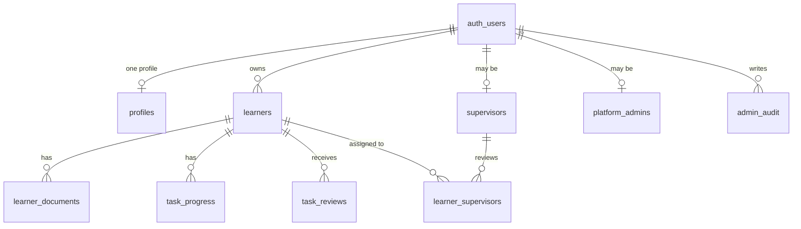
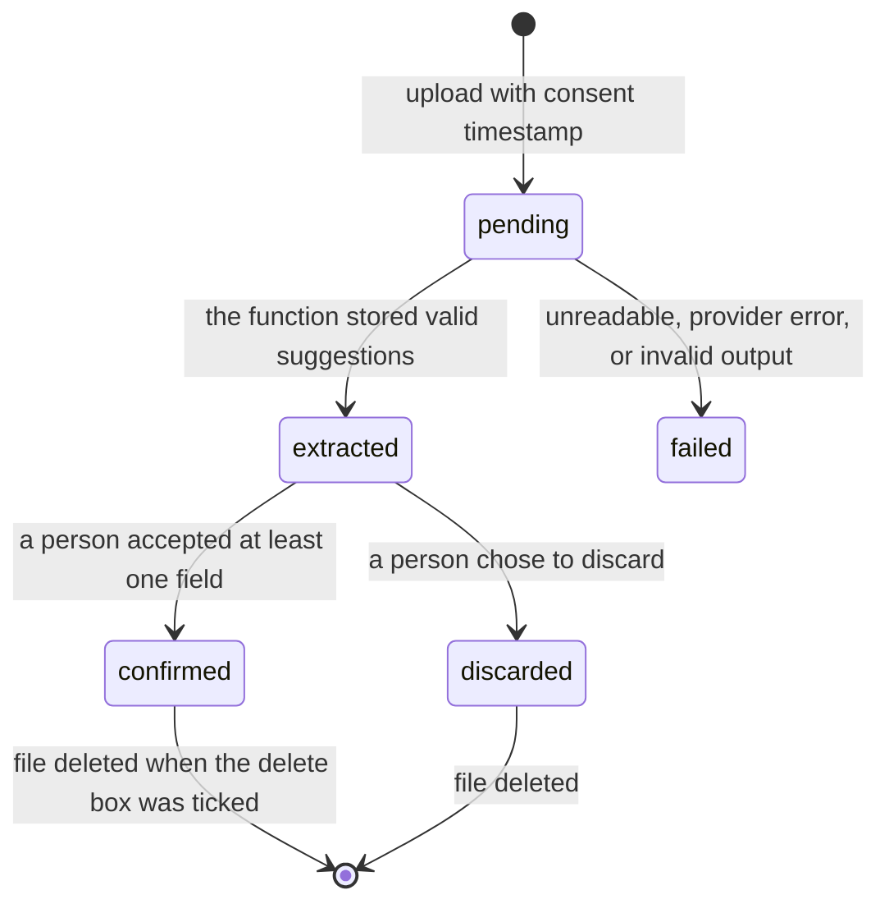

# Security and privacy

This document is the reference for anyone touching learner records, documents, or
reviews. The data is health-adjacent and belongs to a young person, so the rules below
are not stylistic preferences.

## The four rules

1. **Collect only what the record needs.** Every field has a purpose. Optional questions
   say they are optional, and "Not sure" stores nothing.
2. **Store the diagnosis as reported.** The field is labelled "Diagnosis, as it was told
   to you". The application never infers a condition, a level, or a capability from a
   diagnosis.
3. **A diagnosis never changes the screen.** Only function levels (GMFCS, MACS, CFCS), the
   pointer description, the vision description, and fatigue drive adaptations. This is
   enforced by construction: `deriveAdaptations` never reads `reported_diagnosis`, and a
   test asserts that a diagnosis alone leaves the settings at their defaults.
4. **A person confirms every suggested field.** Document reading produces suggestions with
   quoted evidence. Nothing is written to the learner row until the person accepts it.

## What must never be logged

- Learner names, goals, barriers, support needs, or any free-text answer.
- Document contents, file names, or extracted values.
- Access tokens or session details.

The ESLint configuration allows only `console.error` and `console.warn`, and code review
enforces that even those carry no learner data. The one exception is a short label plus a
provider error message in `src/lib/db/helpers.js`.

## Identity and ownership model

- An `auth.users` row owns zero or more `learners` rows through `owner_id`.
- A learner account is an owner whose learner row has `relationship = 'self'`. A unique
  index allows exactly one such row.
- A guardian owns learner rows with a relationship of `parent`, `guardian`, `carer`, or
  `other`, and each of those rows requires `guardian_consent_at`.
- A supervisor is a user with a row in `public.supervisors`. Only a platform admin can
  insert or delete that row. Assignment to a learner is a row in `public.learner_supervisors`.
- A platform admin is a user with a row in `public.platform_admins`. That row is created in
  the SQL editor. The table has no insert policy, so the client cannot grant the role.

## Row level security

Every table has row level security enabled and deny-by-default behaviour. The policies use
`security definer` helpers so a policy never recurses through the row level security
of the table it inspects:

| Helper | Question it answers |
| --- | --- |
| `is_supervisor()` | Does the caller hold the supervisor role? |
| `is_platform_admin()` | Does the caller hold the platform admin role? |
| `owns_learner(id)` | Does the caller own this learner row? |
| `supervises_learner(id)` | Is this learner assigned to the caller as supervisor? |

What each role can do:

| Table | Owner (learner or guardian) | Supervisor | Platform admin |
| --- | --- | --- | --- |
| `profiles` | read and update their own row | read and update their own row | read every profile |
| `platform_admins` | read their own row | read their own row | read their own row |
| `supervisors` | read their own row, which reveals the role | read their own row | read every row, insert, and delete |
| `learners` | read, insert, update, delete their own rows | read rows assigned to them | read every learner |
| `learner_supervisors` | read assignments for their learners | read their own assignments | read, insert, and delete every assignment |
| `learner_documents` | full access to their learners' documents | no access | read every document row. The stored file stays with the owner |
| `task_progress` | read, insert, update, but never set `reviewed` | read assigned learners' progress | read every row |
| `task_reviews` | read | read assigned learners, insert when they supervise that learner and `reviewer_id` is themselves | read every row, insert when `reviewer_id` is themselves |
| `admin_audit` | no access | no access | read every row, insert their own row |

Notes that matter when changing a policy:

- The learner's update policy on `task_progress` has `status <> 'reviewed'` in `USING` and
  `status in ('started','submitted')` in `WITH CHECK`. Both halves are needed: the first
  stops editing a reviewed row, the second stops writing `reviewed` directly.
- `task_reviews` is append-only. There is no update or delete policy, so a review is a
  permanent record of what a supervisor or a platform admin said.
- Admin policies are additive. A supervisor policy is unchanged. Postgres combines
  permissive policies with OR, so an admin who is also a supervisor still matches both.
- Storage policies check the first path segment against `owns_learner_path(text)`. The
  comparison is textual so a malformed folder name denies access instead of raising a cast
  error.

## Document lifecycle

Rules:

- `processing_consent_at` is required at insert. The browser collects the tick box first.
- The bucket is private, with a 10 MB limit and a MIME allow list of PDF, PNG, and JPEG.
- The browser validates type and size before uploading, and the database constraint repeats
  the limits so a direct API call cannot bypass them.
- `confirmExtraction` writes the accepted fields, marks the document `confirmed`, and, when
  the box is ticked, removes the stored object and sets `file_deleted_at`. Deletion is best
  effort: a failure is logged and the record still records the intent.
- Supervisors have no policy on `learner_documents`. They see the fields the person chose
  to keep.
- A platform admin can read every document row, including status and suggestions. Storage
  policies on `learner-documents` stay with the owner, so the file itself is not granted
  to the admin role.

## Authentication

- Email and password through Supabase Auth. Passwords require at least 8 characters in the
  client, and the project's own policy applies server side.
- WebAuthn passkeys are offered only when `window.isSecureContext` is true and
  `PublicKeyCredential` exists, so the control never appears where it cannot work.
- A passkey can be added or removed from the Account page. Removal requires confirmation.
- Passkey errors are translated into short sentences in `src/lib/passkeys.js`, which has unit
  tests, rather than surfacing provider text.

## Threat notes for reviewers

| Scenario | Control |
| --- | --- |
| A learner edits another learner's record | Row level security on ownership, verified by `scripts/rls-check.mjs` |
| A learner approves their own work | Review insert requires the caller to supervise that learner, or to hold the platform admin role, and `reviewer_id` must be the caller. Progress updates still cannot set `reviewed`. A platform admin can review any learner, including one they own |
| A user grants themselves supervisor rights | Insert and delete on `supervisors` are allowed only when `is_platform_admin()` is true |
| A user grants themselves the admin role | `platform_admins` has a select policy for the caller's own row and no insert policy |
| A signed URL leaks a document | Documents use policies rather than public URLs, and the file is deleted on confirmation |
| A malformed storage path crashes a policy | Path ownership compares text, so a bad path returns false |
| Health data reaches analytics or logs | Only `console.error` is permitted, and it carries labels rather than values |

## What still needs a decision

These are recorded as open decisions in the implementation plan and are not solved by the
current build:

- Which extraction provider to use for real documents, and its retention terms.
- Whether under-18 learners may sign up for themselves, or whether a guardian account is
  required for the pilot.
- Which real people act as supervisors, which accounts hold the platform admin role, and
  which learners each supervisor sees.
