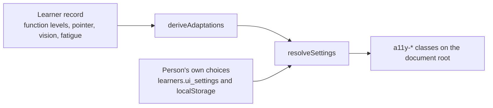

# Adaptive dashboard and profile

## What it covers

How the learner record changes the interface, and how a person edits that record afterwards.

## The rule that shapes everything

**The diagnosis never changes the screen.** Only function levels, the pointer description, the
vision description, fatigue, and the person's own choices do.

This is why the adaptation engine in `src/lib/adaptations.js` takes a learner object and reads
only those six things. A test asserts that a diagnosis with nothing else leaves every setting
at its default.

## Where settings come from, in order

1. `deriveAdaptations` suggests settings from the record.
2. `resolveSettings` lets any stored choice win, key by key.
3. `settingsToClasses` turns the result into class names on `<html>`, and `SiteHeader` applies
   them.

Choices are saved to `learners.ui_settings` (debounced) and to `localStorage`. The local copy
keeps the panel working for a visitor who is not signed in. Reading speed and the light or dark
choice stay on the device only.

## What each setting does

| Setting | Effect |
| --- | --- |
| `textSize` | `large` is 112.5% root font size, `larger` is 125% |
| `highContrast` | Swaps to the high contrast token set |
| `extraSpacing` | Increases line height, letter spacing, and word spacing |
| `reducedMotion` | Disables transitions and animations, and pauses the hero video |
| `targetSize` | Minimum 64px targets for `large`, 88px for `extra-large` |
| `oneThingAtATime` | Changes the dashboard to a single "Your next step" card |
| `extraTime` | Adds the extra time guidance to the pathway copy |

## One thing at a time

When `oneThingAtATime` is on, the dashboard replaces the week overview with a single card:

- The week number, the task title, and the task description.
- One primary action that opens that step.
- The latest supervisor feedback, if there is any.

When it is off, the dashboard shows the pathway card with progress counts and the full
journey link. Both variants show the latest feedback.

## The profile page

`/profile` has four sections, each with its own Save button and its own status message:

| Section | Fields | Component |
| --- | --- | --- |
| Person | Diagnosis as reported, GMFCS, MACS, CFCS, vision, fatigue | `PersonFields` |
| Room | Device, system, screen, pointer, Canva surface, seat, who is in the room | `RoomFields` |
| Goal | Goal, starting point, barriers, support, resources, pace, other details | `GoalFields` |
| Display | Text size, target size, contrast, spacing, motion, one thing at a time, extra time | `DisplaySettingsFields` |

Sections save independently, so a person can change one answer and stop. Each section is
wrapped by a small local `ProfileSection` component, rather than four copies of the same
markup.

For a guardian, the heading reads "Profile for <first name>".

## Why the field groups are shared

The same four groups are mounted in three places: onboarding, the profile page, and, for the
display group, the header panel. They are controlled components with no state of their own and
an `idPrefix` prop, so mounting two of them on one page cannot create duplicate element ids.

This is the concrete answer to the "do not duplicate markup" rule in `AGENTS.md`: a question is
written once, and every place it appears asks it the same way.

## Re-deriving after a change

When the person saves a change that affects function levels or the room, the display settings
derive again from the updated record on the next render. A person's explicit choices are not
overwritten by that re-derivation, because `resolveSettings` always applies overrides last.

## Known limits

- A guardian cannot switch between multiple learner records in the interface yet.
- There is no history of previous display settings; only the current choice is stored.
- The profile does not warn before leaving with unsaved edits in another section.
