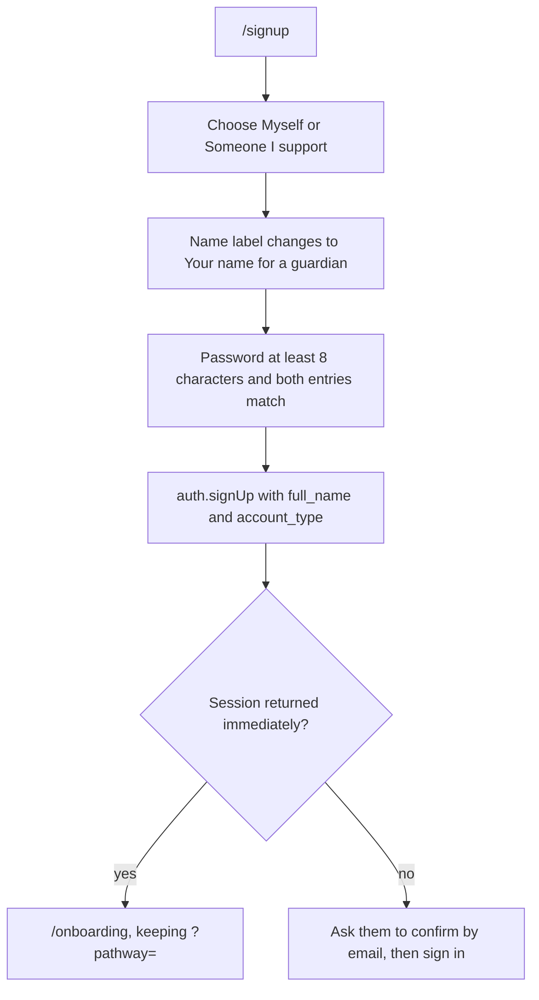

# Authentication and passkeys

## What it covers

Creating an account as a learner or as the adult who supports one, signing in with email and
password, and adding face or fingerprint sign-in on a device.

## Account types

At sign-up a person chooses one of two account types. The choice is stored once, in the
`account_type` column of `public.profiles`, copied from user metadata by the
`handle_new_user` trigger.

| Choice | Label | What it means |
| --- | --- | --- |
| `learner` | Myself | The account holder is the learner. The learner row created in onboarding uses `relationship = 'self'` |
| `guardian` | Someone I support | The account holder is a parent, guardian, or carer. Onboarding asks for the learner's first name, the relationship, and consent |

The choice is not changeable after sign-up in this build. A guardian who later needs their own
learner record would need a second account or a future profile switch. This is a known limit.

## Sign-up flow

- The password minimum is 8 characters, checked in the browser and enforced again by the
  project's own policy.
- The name field asks for a full name for a learner and "Your name" for a guardian, because a
  guardian is not the learner.
- `?pathway=` survives the redirect so the selected pathway is still shown afterwards.

## Sign-in flow

`/signin` offers passkey sign-in first when it is available, then email and password.

- The destination is `/dashboard` unless a guard redirected here, in which case the intended
  path is restored from router state.
- Both password fields in the app use `PasswordField`, so the show and hide control and its
  accessible label are identical everywhere.
- Passkey failures are translated by `passkeyErrorMessage` into sentences such as "The face or
  fingerprint check was cancelled or timed out."

## Passkeys

Passkeys are WebAuthn credentials held by the device. The site never receives a face or a
fingerprint.

Availability is decided once, at load: `window.isSecureContext` must be true and
`window.PublicKeyCredential` must be a function. The control is hidden rather than shown
broken.

| Action | Function | Where |
| --- | --- | --- |
| Sign in with a passkey | `signInWithPasskey()` | `/signin` |
| Add this device | `registerPasskey()` | `/account` |
| List devices | `listPasskeys()` | `/account` |
| Remove a device | `removePasskey(id)` | `/account` |

The Account page lists each passkey with a friendly name, the date it was added, and the last
time it was used. Removing one asks for confirmation and explains that email and password
still work.

## Error handling

| Situation | What the person sees |
| --- | --- |
| Supabase environment missing | "Account services are unavailable because Supabase is not configured." |
| Cancelled or timed-out ceremony | A sentence explaining the check was cancelled and can be retried |
| Device already registered | A sentence explaining this device is already set up |
| Expired challenge | "That took too long. Please try again." |
| Anything else | The provider message if present, otherwise a plain fallback |

`src/lib/passkeys.test.js` covers the translation table and the date formatter.

## Known limits

- No password reset flow is built. A person who forgets their password currently has no
  self-service route, which must be resolved before the pilot reaches people outside the
  build team.
- No email change flow.
- No account deletion flow. Removing a learner row deletes its progress, reviews, and
  documents through cascade rules, but there is no interface for it yet.
