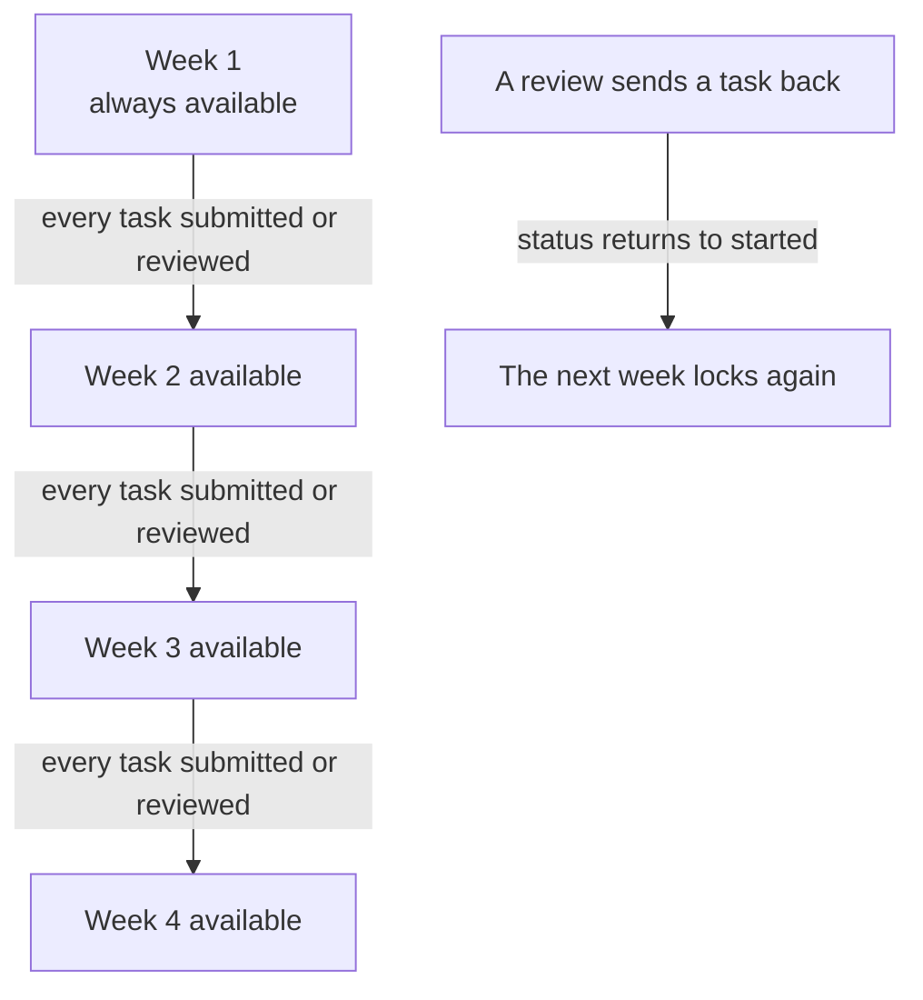

# Canva pathway and supervisor reviews

## What it covers

How a learner moves through the four-week Canva pathway, how a step reaches a supervisor, and
what a supervisor can record.

## The pathway

Defined in `src/data/learningPaths.js`. One pathway, `canva-design-project`, with four weeks of
three tasks each. Every task has:

| Field | Purpose |
| --- | --- |
| `id` | Stable identifier, for example `w2-t1`. This is what `task_progress` stores |
| `title`, `description` | What the learner sees |
| `canvaUrl` | Where "Start in Canva" opens |
| `reviewPrompt` | What the supervisor checks, shown on the review form |

Changing content is a data edit. Progress rows already recorded against a task id keep working.

## Step states

| Status | Meaning | Written by |
| --- | --- | --- |
| `started` | The learner opened the step | Learner |
| `submitted` | The learner sent it for review | Learner |
| `reviewed` | A supervisor marked it done | The review trigger only |

The learner's update policy allows only `started` and `submitted`. There is no path by which a
learner can write `reviewed`, and no client insert policy on `task_reviews` for a non-supervisor.

## Week unlocking

Implemented as `getWeekStatus(pathway, rows, weekIndex)` in `src/utils/progress.js`, which
returns `locked`, `available`, `review`, or `complete`:

- `complete` when every task in the week is `reviewed`.
- `review` when at least one task in the week is `submitted`.
- `available` for week 1, or when the previous week is fully submitted or reviewed.
- `locked` otherwise.

Unlocking on submission, rather than on approval, is deliberate: a slow review must not stop a
learner working. This is recorded as an open decision in the plan and can be revisited.

## The Canva handoff

Canva is a separate application, so the step happens outside the app.

1. The learner presses **Start in Canva**. `startTask` records `started`, then the Canva URL
   opens in a new tab with `noopener,noreferrer`.
2. The task id is stored in `sessionStorage` as the pending task.
3. When the learner returns and the window regains focus, the page offers a "Back from Canva?"
   panel with an optional design link and an optional note.
4. **Send for review** calls `submitTask`, which sets `submitted` and `submitted_at`.

Each task also carries an inline submit control, so a learner who dismissed the panel can still
submit from the list. Both use the same local `SubmitPanel` component.

## The supervisor view

`/supervisor` lists assigned learners with a count of steps awaiting review. Opening a learner
shows:

- The person and room summary, read only, through `PersonRoomSummary`.
- The goal section, read only.
- Each week, with each task and its status.
- For a submitted task: the design link, the learner's note, the `reviewPrompt`, and the review
  form.
- The newest review for the task, through `ReviewFeedbackCard`.

The review form requires three things and offers one optional field:

| Field | Required | Notes |
| --- | --- | --- |
| Done or Not yet | Yes | Drives `marked_done`, and therefore the next status |
| Rating 1 to 5 | Yes | Buttons labelled 1 to 5 with a text legend, so the meaning does not rely on colour |
| Comment | Yes | Shown to the learner |
| Access change | No | "What changed so the step could be done" |

On save, `createReview` inserts a row. The `on_task_review` trigger then sets the step to
`reviewed` for "Done" or back to `started` for "Not yet". The learner sees the new status and the
feedback on the dashboard and on the journey page.

## Why reviews are append-only

A review is a record of what a supervisor said at a moment in time, next to what the learner had
submitted. Editing or deleting one would erase that record. There is therefore no update or
delete policy on `task_reviews`; a correction is a new review.

The newest review per task is the current one, computed by `latestReviewByTask`.

## Supervisor provisioning

Supervisors are created by a person with database access, not by invitation. The SQL is in
[database-schema.md](../reference/database-schema.md#supervisor-provisioning).

## Known limits

- One pathway. The schema is pathway-agnostic but the catalogue holds a single entry.
- No notification when a step is submitted. A supervisor checks the list.
- No batch review; each task is reviewed on its own.
- The Canva URL is the generic site until a specific template link is agreed.
