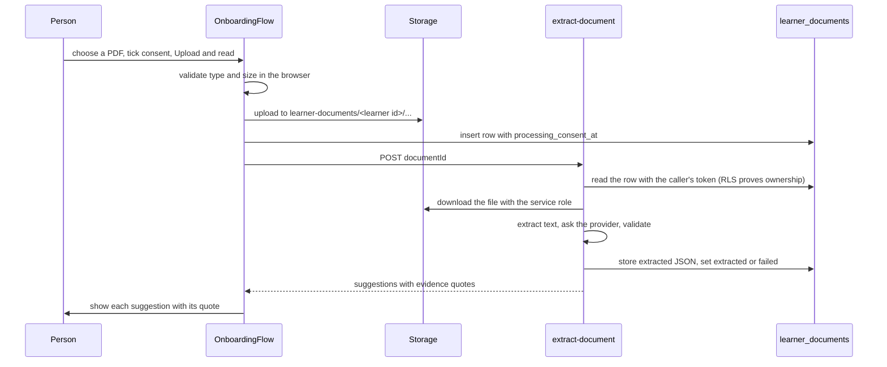

# Onboarding and document extraction

## What it covers

The seven steps that create a learner record, including the optional document upload and the
step where a person confirms each suggested answer.

## Why it is a flow, not one form

The record holds sensitive information about a young person. Asking seven short groups gives
the person a place to stop, and it means the resume point is a single column:
`public.learners.onboarding_step`.

## Steps

| Step | Key | Required | Saves on continue |
| --- | --- | --- | --- |
| 1 | `who` | First name, and consent for a guardian | Creates the learner row with `onboarding_step = 'document'` |
| 2 | `document` | No | Uploads a file, requests extraction, and moves to `confirm` |
| 3 | `confirm` | No | Writes the accepted fields, marks the document confirmed, optionally deletes the file |
| 4 | `person` | No | Diagnosis, GMFCS, MACS, CFCS, vision, fatigue |
| 5 | `room` | No | Device, system, screen, pointer, Canva surface, seat, who is in the room |
| 6 | `goals` | Goal | Goal, starting point, barriers, support, resources, pace, other details |
| 7 | `display` | No | The resolved display settings, then `onboarding_completed_at` |

A step is saved before the next one is shown, so closing the tab never loses completed work.
"Leave and finish later" from any step goes to the dashboard, which offers to continue.

## Required fields

Only three things are required, and they are required for good reason:

- **A first name**, because every screen addresses the person by it.
- **A goal**, because the pathway is meant to follow a chosen goal.
- **Guardian consent**, when the account holder is not the learner.

Everything else can be skipped. "Not sure" is offered on all three function scales and stores
`null`.

## The step shell

Every step renders through `OnboardingStep`, which provides:

- A progress list with the current step marked `aria-current="step"` and a "Step N of 7"
  counter.
- One `h1` that takes focus when the step changes.
- One primary submit button, a Back button, and an error region.
- "Leave and finish later".

This is the reason the seven steps share navigation behaviour without duplicating it.

## Document extraction

### What the person sees

For each suggested field the Confirm step shows the suggested value, the quoted words from
the document, and three choices: Accept, Edit, or Leave out. Editing reveals an input
prefilled with the suggestion.

A checkbox, on by default, reads "Delete the document after I confirm". Confirming writes the
accepted fields and, when the box is ticked, removes the stored file.

### What happens when reading fails

- No readable text, a provider error, or output that fails validation sets the document to
  `failed`.
- The person is told the result did not look reliable and is taken to the Person step to type
  the answers instead.
- Discarding marks the document `discarded` and deletes the file.

### Why the mock provider exists

The default provider returns a fixed sample. That lets the entire flow, including the evidence
display and the delete-on-confirm behaviour, be rehearsed without sending a health document to
a third party. Choosing a real provider is an open decision with a data processing question
attached, not a code shortcut.

## Validation

The same seven rules are enforced on both sides. On the server they are authoritative; in the
browser they exist so the confirm screen can show what was suggested and refuse anything
malformed.

Allowed keys: `reported_diagnosis`, `gmfcs`, `macs`, `cfcs`, `vision`, `fatigue`, `support`.

Tests: `src/lib/extraction.test.js` covers the sample, an unknown key, a level of 6, a
fractional level, a value with no evidence, a payload that is not an object, and a flat payload
without the `fields` wrapper.

## Known limits

- Images are accepted for storage but cannot be turned into text without a vision provider, so
  they end as `failed` with a clear message.
- Only one document is handled per onboarding run.
- A guardian cannot add a second learner from the interface yet, although the schema and
  policies support it.
