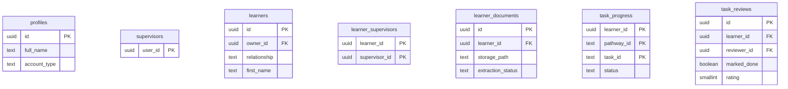

# Database schema reference

Source of truth: `supabase/migrations/`. The learner record is
`20261028000000_learner_record.sql`. Platform administration is
`20261029100000_platform_admin.sql`. The supervisors-to-profiles foreign key is
`20261029120000_supervisors_profile_fk.sql`. Apply with `npx supabase db push`.

## Entity overview



## `public.profiles`

One row per authenticated user, created by a trigger on `auth.users`.

| Column | Type | Notes |
| --- | --- | --- |
| `id` | uuid, primary key | References `auth.users(id)` with `on delete cascade` |
| `full_name` | text | Copied from `raw_user_meta_data ->> 'full_name'` at sign-up |
| `account_type` | text, not null, default `'learner'` | `learner` or `guardian`, from metadata |
| `created_at`, `updated_at` | timestamptz, not null, default `now()` | `updated_at` maintained by trigger |

## `public.supervisors`

The supervisor role. Rows are inserted in the SQL editor only; no client policy allows
insert.

| Column | Type | Notes |
| --- | --- | --- |
| `user_id` | uuid, primary key | References `auth.users(id)` and `profiles(id)` |
| `created_at` | timestamptz, not null | |

`supervisors_profile_fk` is what lets a query embed a profile name from a supervisor row.
Deleting the profile removes the supervisor role.

## `public.platform_admins`

The EABD team role. Granted in the SQL editor. There is no insert policy for ordinary users.
The only select policy returns the caller's own row.

| Column | Type | Notes |
| --- | --- | --- |
| `user_id` | uuid, primary key | References `auth.users(id)` with `on delete cascade` |
| `created_at` | timestamptz, not null | |

## `public.admin_audit`

Append-only record of administrative actions that are not already a review. Readable by
admins. The actor inserts their own row. There is no update or delete policy.

| Column | Type | Notes |
| --- | --- | --- |
| `id` | uuid, primary key | |
| `actor_id` | uuid, not null | The admin who acted |
| `action` | text, not null | `review_created`, `learner_assigned`, `learner_unassigned`, `supervisor_granted`, `supervisor_revoked`, `document_deleted` |
| `learner_id` | uuid | Set null if the learner is later deleted |
| `target_user_id` | uuid | The other account, when the action has one |
| `detail` | jsonb, not null | A small payload, default `{}` |
| `created_at` | timestamptz, not null | |

Who may read and write each table is described in
[administration.md](administration.md).

## `public.learners`

The record itself. One self record per owner; a guardian may hold several learner rows.

| Column | Type | Notes |
| --- | --- | --- |
| `id` | uuid, primary key, default `gen_random_uuid()` | |
| `owner_id` | uuid, not null | References `auth.users(id)` |
| `relationship` | text, not null | `self`, `parent`, `guardian`, `carer`, `other` |
| `first_name` | text, not null | Must contain a non-space character |
| `guardian_consent_at` | timestamptz | Required when `relationship <> 'self'` |
| `reported_diagnosis` | text | Stored as reported; never read by adaptation rules |
| `gmfcs`, `macs`, `cfcs` | smallint | Each between 1 and 5, or null for "Not sure" |
| `vision`, `fatigue` | text | Free text descriptions |
| `device`, `device_os`, `screen`, `pointer`, `seat`, `who_in_room` | text | The room description |
| `canva_surface` | text | `app` or `browser` |
| `goal`, `starting_point`, `barriers`, `support`, `resources`, `other_details` | text | The goal description |
| `learning_pace` | text | `guided`, `flexible`, `independent` |
| `ui_settings` | jsonb, not null, default `{}` | Display overrides chosen by the person |
| `onboarding_step` | text, not null, default `'who'` | Resume point, including `'done'` |
| `onboarding_completed_at` | timestamptz | Set on the final step |
| `created_at`, `updated_at` | timestamptz, not null | |

Constraints and indexes:

- `guardian_needs_consent`: `relationship = 'self' or guardian_consent_at is not null`
- `learners_one_self_record`: unique index on `owner_id` where `relationship = 'self'`
- `learners_owner_idx`: index on `owner_id` for the owner lookup

## `public.learner_supervisors`

Assignment of a supervisor to a learner.

| Column | Type | Notes |
| --- | --- | --- |
| `learner_id` | uuid | References `learners(id)`, part of the primary key |
| `supervisor_id` | uuid | References `supervisors(user_id)`, part of the primary key |
| `created_at` | timestamptz, not null | |

Index `learner_supervisors_supervisor_idx` on `supervisor_id`.

## `public.learner_documents`

An uploaded document and the outcome of reading it.

| Column | Type | Notes |
| --- | --- | --- |
| `id` | uuid, primary key | |
| `learner_id` | uuid, not null | References `learners(id)` |
| `storage_path` | text, not null, unique | `<learner_id>/<uuid>-<file name>` |
| `file_name` | text, not null | The original name, shown to the person |
| `mime_type` | text, not null | `application/pdf`, `image/png`, `image/jpeg` |
| `size_bytes` | integer, not null | Greater than 0 and at most 10485760 |
| `uploaded_by` | uuid, not null | References `auth.users(id)` |
| `processing_consent_at` | timestamptz, not null | Recorded before upload |
| `extraction_status` | text, not null, default `'pending'` | `pending`, `extracted`, `failed`, `confirmed`, `discarded` |
| `extracted` | jsonb | The validated suggestions, keyed by field |
| `extraction_error` | text | Short reason, never document text |
| `extracted_at`, `confirmed_at`, `file_deleted_at` | timestamptz | Lifecycle timestamps |
| `created_at` | timestamptz, not null | |

Index `learner_documents_learner_idx` on `learner_id`.

## `public.task_progress`

One row per learner, pathway, and task. Primary key is the triple.

| Column | Type | Notes |
| --- | --- | --- |
| `learner_id` | uuid | References `learners(id)` |
| `pathway_id` | text | Matches `learningPaths[].id` |
| `task_id` | text | Matches `learningPaths[].weeks[].tasks[].id` |
| `status` | text, not null, default `'started'` | `started`, `submitted`, `reviewed` |
| `started_at` | timestamptz, not null | |
| `submitted_at` | timestamptz | Set by `submitTask` |
| `design_link` | text | Optional learner-supplied URL |
| `learner_note` | text | At most 2000 characters |
| `updated_at` | timestamptz, not null | Maintained by trigger |

## `public.task_reviews`

Append-only supervisor reviews. The newest review for a task is the current one.

| Column | Type | Notes |
| --- | --- | --- |
| `id` | uuid, primary key | |
| `learner_id` | uuid, not null | References `learners(id)` |
| `pathway_id`, `task_id` | text, not null | |
| `reviewer_id` | uuid, not null | Must equal `auth.uid()` under the insert policy |
| `marked_done` | boolean, not null | Drives the step status through the trigger |
| `rating` | smallint, not null | 1 to 5 |
| `review` | text, not null | Must contain a non-space character |
| `access_change` | text | Optional note on what made the step possible |
| `created_at` | timestamptz, not null | |

Index `task_reviews_lookup` on `(learner_id, pathway_id, task_id, created_at desc)`.

## Functions

| Function | Returns | Notes |
| --- | --- | --- |
| `is_supervisor()` | boolean | `security definer`, stable |
| `is_platform_admin()` | boolean | `security definer`, stable. True when `auth.uid()` is in `platform_admins` |
| `owns_learner(uuid)` | boolean | `security definer`, stable |
| `supervises_learner(uuid)` | boolean | `security definer`, stable |
| `owns_learner_path(text)` | boolean | Storage path variant, compares text to avoid a cast error |
| `handle_new_user()` | trigger | Inserts the profile row from user metadata |
| `apply_review()` | trigger | Copies the review outcome onto `task_progress` |
| `touch_updated_at()` | trigger | Sets `updated_at` on update |

## Triggers

| Trigger | Table | Timing |
| --- | --- | --- |
| `on_auth_user_created` | `auth.users` | after insert, for each row |
| `on_task_review` | `public.task_reviews` | after insert, for each row |
| `profiles_touch` | `public.profiles` | before update |
| `learners_touch` | `public.learners` | before update |
| `task_progress_touch` | `public.task_progress` | before update |

## Storage

Bucket `learner-documents`, private.

| Setting | Value |
| --- | --- |
| `public` | false |
| `file_size_limit` | 10485760 bytes |
| `allowed_mime_types` | `application/pdf`, `image/png`, `image/jpeg` |

Path convention: `<learner_id>/<uuid>-<sanitised file name>`. Policies allow select,
insert, and delete only when the first path segment is a learner the caller owns. There is
no supervisor policy on storage.

## Supervisor provisioning

Run in the SQL editor after the supervisor account exists:

```sql
insert into public.supervisors (user_id)
select id from auth.users where email = '<supervisor email>';

insert into public.learner_supervisors (learner_id, supervisor_id)
select l.id, s.user_id
from public.learners l, public.supervisors s
where l.first_name = '<learner first name>'
  and s.user_id = (select id from auth.users where email = '<supervisor email>');
```

## Verifying the policies

`scripts/rls-check.mjs` signs in as two learners and a supervisor and asserts the eleven
behaviours described in [../guides/testing-and-quality.md](../guides/testing-and-quality.md).
Run it after any migration that touches these tables.
